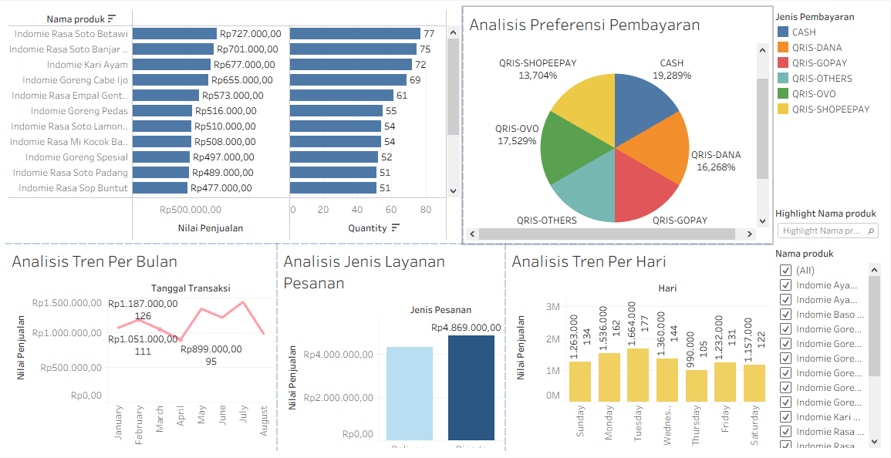

# Analisis Penjualan Warmindo 2022

Merapikan 499 transaksi dengan Excel dan menyajikannya dalam dashboard Tableau untuk melihat menu, hari, dan pola pembayaran yang menggerakkan omzet.

See Details for public [Tableau]([https://github.com/farrelru76](https://public.tableau.com/app/profile/geccco.utama/viz/Book1_17901849017310/Dashboard12?publish=yes))



## Latar Belakang

Warung kecil seperti warmindo biasanya hanya mencatat penjualan tanpa dianalisis, sehingga pemilik sulit menjawab pertanyaan dasar: menu mana yang paling laku, kapan warung ramai atau sepi, dan bagaimana pelanggan membayar. Proyek ini mengubah data transaksi mentah menjadi insight dan rekomendasi bisnis yang bisa langsung dipakai.

## Tujuan

1. Mengukur performa penjualan warmindo secara keseluruhan.
2. Mengidentifikasi menu terlaris dan menu dengan penjualan rendah.
3. Menganalisis pola penjualan per bulan dan per hari.
4. Memahami preferensi pelanggan pada jenis pesanan (Dine-In dan Delivery) dan metode pembayaran.
5. Menyusun rekomendasi bisnis berdasarkan temuan.

## Dataset

| Item | Keterangan |
|---|---|
| Periode | Januari sampai Agustus 2022 |
| Jumlah transaksi | 499 baris |
| Menu | 18 varian (mie kuah dan mie goreng) |
| Pelanggan | 99 |
| Porsi terjual | 975 |
| Total omzet | Rp9.202.000 |

Kolom utama: `invoice_id`, `tanggal_transaksi`, `customer_id`, `nama_produk`, `jenis_produk`, `kategori_produk`, `quantity`, `harga_jual`, `jenis_pembayaran`, `jenis_pesanan`, `nilai_penjualan`.

## Alat

- **Microsoft Excel:** data cleaning dan pivot table
- **Tableau:** dashboard dan storytelling

## Metodologi

### 1. Data cleaning (Excel)

Data mentah disimpan di sheet `Penjualan warmindo` dan tidak diubah. Pembersihan dilakukan di sheet salinan `data clean`.

| Masalah | Perlakuan |
|---|---|
| Penulisan nama produk tidak seragam (`indomie Kari Ayam` vs `Indomie Kari Ayam`) | Diseragamkan agar satu menu tidak terhitung sebagai dua produk. Hasilnya 18 menu. |
| Tidak ada informasi hari | Menambahkan kolom `Hari` dari tanggal transaksi. |
| Nilai penjualan perlu diverifikasi | Menambahkan kolom `validasi nilai penjualan` untuk memeriksa harga jual × jumlah. |
| Metode pembayaran terpecah (OVO, GoPay, DANA, ShopeePay, dan lainnya) | Dikelompokkan menjadi QRIS dan tunai. |

### 2. Analisis (Excel)

Pivot table merangkum penjualan per produk, bulan, hari, jenis pesanan, dan metode pembayaran. Hasilnya ada di sheet `table pivot`.

### 3. Visualisasi (Tableau)

Dashboard terdiri dari enam analisis yang disusun dalam satu story:

- Analisis performa produk
- Analisis tren per bulan
- Analisis tren per hari
- Total omzet vs rata-rata nilai transaksi per bulan
- Analisis jenis layanan pesanan
- Analisis preferensi pembayaran

## Temuan Utama

- **Menu terlaris:** Indomie Rasa Soto Betawi (Rp727 ribu), Soto Banjar Limau Kuit (Rp701 ribu), dan Kari Ayam (Rp677 ribu). Omzet terendah ada pada Soto Mie (Rp330 ribu).
- **Jenis produk:** mie kuah menyumbang sekitar 71% omzet (Rp6,57 juta), mie goreng Rp2,64 juta.
- **Tren bulanan:** puncak pada Juli (Rp1,45 juta; 152 porsi dari 80 transaksi), terendah pada April (Rp899 ribu; 95 porsi dari 49 transaksi), yang bertepatan dengan Ramadan.
- **Tren harian:** Selasa (Rp1,66 juta) dan Senin (Rp1,54 juta) paling ramai. Kamis paling sepi (sekitar Rp990 ribu).
- **Nilai transaksi:** rata-rata sekitar Rp18.441 per transaksi (1,95 porsi per kunjungan), dengan variasi antar bulan kecil (Rp17.574 sampai Rp19.640). Naik-turunnya omzet lebih dipengaruhi jumlah kunjungan daripada besar belanja.
- **Jenis pesanan:** Dine-In (Rp4,87 juta) dan Delivery (Rp4,33 juta) hampir seimbang.
- **Pembayaran:** sekitar 80,7% transaksi memakai QRIS dan 19,3% tunai.

## Rekomendasi Bisnis

- Jadikan menu terlaris sebagai andalan di papan menu dan promosi digital. Menu yang kurang laku bisa dibundling dengan minuman.
- Buat promo khusus di hari sepi (Kamis) dan bulan sepi (Ramadan), serta siapkan stok dan kapasitas lebih saat bulan ramai seperti Juli.
- Fokus menambah frekuensi kunjungan dan nilai belanja per transaksi, misalnya lewat paket hemat atau menu tambahan.
- Jaga kualitas makanan saat dikemas untuk delivery, dan tingkatkan kenyamanan area makan di tempat.
- Pastikan jaringan internet dan kode QRIS selalu lancar, dan pertimbangkan promo cashback bersama penyedia dompet digital.

## Struktur Repositori

```
├── Penjualan_warmindo_analysis.xlsx   # data mentah, data clean, pivot table, insight
├── Penjualan_Warmindo.twbx            # workbook Tableau (dashboard)
├── images/                            # screenshot dashboard
└── README.md
```

## Cara Membuka

1. Unduh repositori ini.
2. Buka `Penjualan_warmindo_analysis.xlsx` di Microsoft Excel untuk melihat data, pivot table, dan insight.
3. Buka `Penjualan_Warmindo.twbx` di Tableau Desktop atau Tableau Public untuk melihat dashboard.

## Kontak

**Farrel Rizki Utama**

- Email: farrelru76@gmail.com
- LinkedIn: [farrel-rizki-utama](https://www.linkedin.com/in/farrel-rizki-utama-866849267)
- GitHub: [farrelru76](https://github.com/farrelru76)
